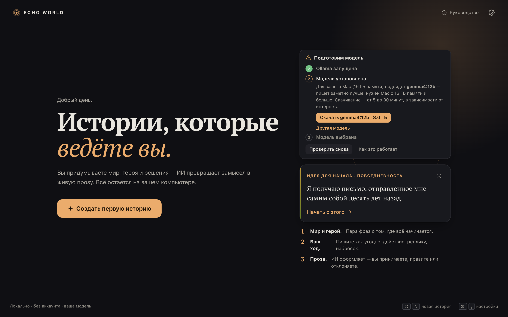
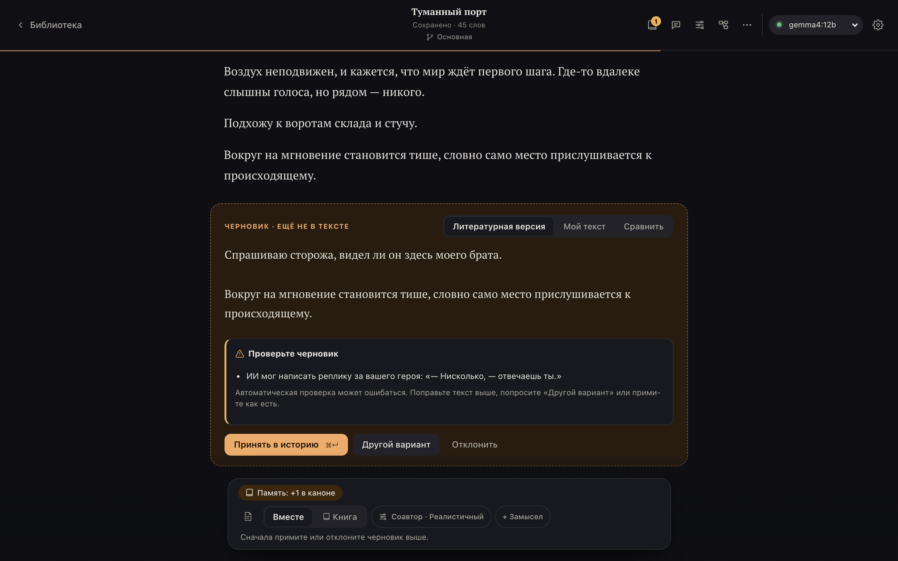
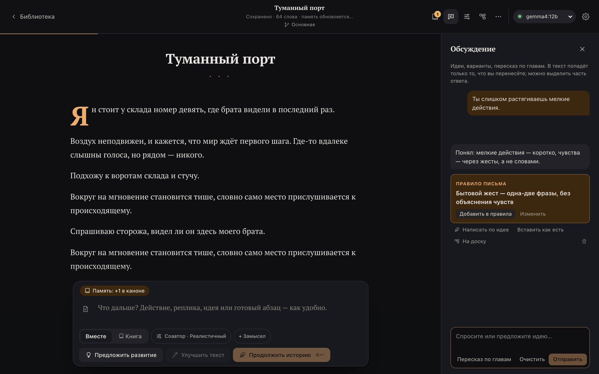
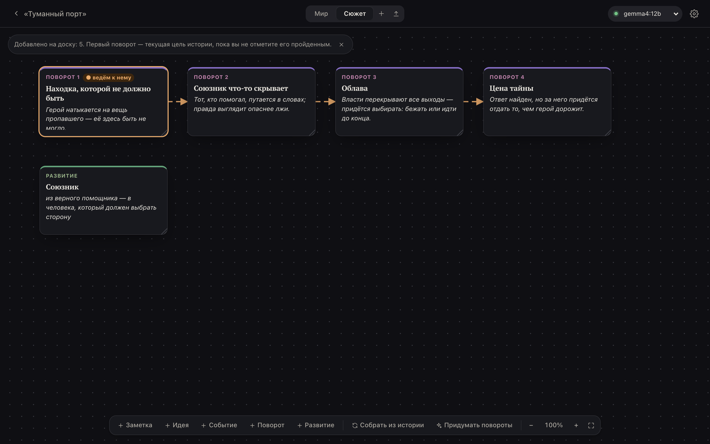
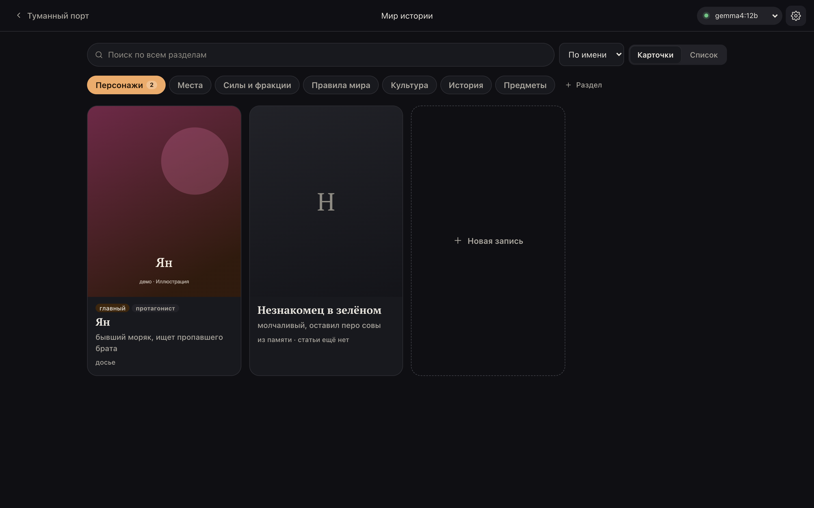
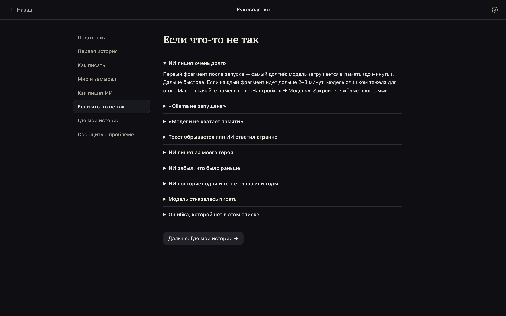

# ECHO WORLD

**Истории, которые ведёте вы.** Приложение для macOS, Windows и Linux, в котором вы пишете художественные истории вместе с нейросетью. Вы придумываете мир, героя и решения, а ИИ превращает ваш замысел в прозу, помнит канон и не решает за вашего героя.

Нейросеть работает **прямо на вашем компьютере**: тексты никуда не отправляются, аккаунт не нужен, интернет нужен только чтобы один раз скачать модель.

> **Бета-версия.** Это открытая версия для тестирования — **1.0.0-beta.7**. Что-то может работать не так, как ожидается, а данные могут потеряться — делайте копии важных историй («Ещё → Экспорт»). Отзывы очень нужны: [как сообщить о проблеме](#отзывы-и-ошибки).

**[⬇ Скачать для macOS, Windows и Linux](https://github.com/ognewmax-eng/echo-world-app/releases/tag/v1.0.0-beta.7)** · [Установка](docs/INSTALL.md) · [Руководство](docs/GUIDE.md) · [Что нового](CHANGELOG.md)

## Что можно делать

**Писать вместе с ИИ.** Вы пишете ход как удобно: действие, реплику, набросок или «пусть начнётся дождь». ИИ возвращает литературный фрагмент. Это черновик, в историю он попадает только когда вы нажмёте «Принять». Его можно поправить, попросить другой вариант или отклонить.

- **Три способа начать.** Заполнить пару полей самому, «Придумать мир с ИИ» по одной строке или «Обсудить с ИИ», как в чате.
- **Три способа писать.**
  - «Вместе» — вы ведёте героя, ИИ пишет мир и последствия.
  - «Книга» — ИИ сам пишет главу из нескольких частей, вы читаете и направляете.
  - «Обсуждение» — чат об истории, удачные идеи переносятся в текст.
- **Героя ведёте вы.** ИИ не пишет за вашего героя решения и реплики, а приложение проверяет черновик и предупреждает, если ИИ всё-таки забылся.

**Поправить, как пишет ИИ.** Стиль (классический, лаконичный, кинематографичный… или ваш собственный — по образцу вашего текста), лицо и время, тон, рейтинг, приёмы драматургии. Если ИИ раз за разом делает что-то не так, скажите ему об этом в «Обсуждении», и он предложит **правило письма**, которое будет соблюдать дальше.

**Держать замысел.** На доске раскладываются повороты сюжета, развитие персонажей и заметки. ИИ ведёт историю к следующему повороту, а «Придумать повороты» предложит план. Холст из **Obsidian** (`.canvas`) переносится на доску или сразу становится основой новой истории — [как его составить](docs/obsidian/CANVAS.md).

**Помнить мир.** ИИ сам запоминает факты, персонажей и открытые сюжетные линии. «Мир истории» — вики с досье, местами, правилами мира и отношениями. Всё, что там записано, ИИ держит при письме; что удалено — забывает. Мир можно написать в любом редакторе и **загрузить одним файлом `.md`**, а можно сохранить в файл и перенести в другую историю: [шаблон и описание](docs/world/WORLD-MD.md).

**Слушать главы.** Главы может читать вслух Voicebox — отдельная бесплатная программа, которая работает на вашем компьютере или в домашней сети: вашим голосом или встроенным. Это необязательно — [как настроить](docs/INSTALL.md#озвучка-необязательно).

**И ещё:**
- ветки «а что если»;
- главы и пересказы глав;
- заметки автора, которые ИИ не видит;
- экспорт в EPUB, Markdown и страницу для печати в PDF;
- архив истории для переноса на другой компьютер;
- автоматические копии раз в день;
- светлая и тёмная темы, два варианта оформления.

**Справиться без помощи.** При первом запуске приложение само запускает Ollama и скачивает модель, которая подходит вашему компьютеру. Встроенное руководство отвечает на частые вопросы, а у каждой ошибки сказано, что делать.

Скриншоты сделаны в демо-режиме: текст в черновиках и портрет условные. Настоящая модель пишет полноценную прозу.

## Скачать

| Система | Файл |
|---|---|
| **macOS** 13+ (Apple Silicon и Intel) | `ECHO-WORLD_1.0.0-beta.7_macos-universal.dmg` |
| **Windows** 10/11, 64 бит | `ECHO-WORLD_1.0.0-beta.7_windows-x64-setup.exe` |
| **Linux** x86_64 (Ubuntu 22.04+, Debian 12+, Fedora 36+…) | `ECHO-WORLD_1.0.0-beta.7_linux-x86_64.AppImage` или `echo-world_1.0.0-beta.7_amd64.deb` |

Все файлы — на [странице релиза](https://github.com/ognewmax-eng/echo-world-app/releases/tag/v1.0.0-beta.7).

## Что нужно

| | Минимум | Чтобы писать хорошо |
|---|---|---|
| Память | 8 ГБ | Mac на Apple Silicon с 16 ГБ или видеокарта NVIDIA с 12 ГБ |
| Диск | ~5 ГБ | ~10 ГБ |
| Ollama | Бесплатная программа, которая запускает нейросеть. Приложение подскажет, где её взять | |

Без видеокарты (или на Mac с Intel) всё работает, но медленнее: фрагмент пишется минуту-две.

## Как начать

1. Скачайте файл для своей системы.
2. Установите. Бета не подписана, поэтому macOS и Windows один раз предупредят. Как ответить и всё остальное по шагам для каждой системы — в **[полной инструкции](docs/INSTALL.md)**.
3. На главном экране — карточка «Подготовим модель»: «Запустить Ollama» → «Скачать …». Загрузка модели займёт от 5 до 30 минут.
4. «Создать первую историю».

Дальше — [руководство](docs/GUIDE.md). Оно же есть внутри приложения: кнопка «Руководство» на главном экране.

## Приватность

- Истории хранятся только на вашем компьютере ([где именно](docs/INSTALL.md#где-хранятся-истории)).
- Нейросеть работает локально через Ollama, тексты никуда не отправляются.
- Приложение не собирает статистику и не ходит в интернет. Исключения:
  - загрузка модели по вашей кнопке (из библиотеки Ollama);
  - ссылка на сайт Ollama;
  - компьютер с ИИ, ComfyUI или Voicebox в вашей домашней сети — только если вы сами его подключите в настройках.

## Отзывы и ошибки

Нужно всё: и «не понял, куда нажать», и «ИИ написал ерунду».

- **[Сообщить об ошибке](https://github.com/ognewmax-eng/echo-world-app/issues/new?template=bug.yml)** или **[предложить идею](https://github.com/ognewmax-eng/echo-world-app/issues/new?template=idea.yml)** — нужен аккаунт GitHub.
- Нет аккаунта — напишите тому, кто дал вам ссылку.

Что приложить: в приложении «Руководство → Сообщить о проблеме» → «Скопировать сведения» (версия, система, модель, память — без текстов ваших историй), снимок экрана и, если была ошибка, её «Подробности».

## Известные ограничения беты

- Приложение не подписано: macOS и Windows при первом запуске просят разрешения ([как ответить](docs/INSTALL.md)).
- Больше всего проверено на macOS, Windows проверена на ПК с видеокартой NVIDIA. Версия для Linux пока проверена только автоматически — особенно ждём отзывов с Linux.
- Видеокарты AMD приложение не распознаёт: большую модель выбирайте сами («Другая модель»).
- Автообновления нет: новую версию скачивайте отсюда и ставьте поверх, истории сохранятся.
- Качество текста зависит от модели. Компактная gemma3:4b пишет проще и иногда сбивается; gemma4:12b заметно лучше, но нужен Mac с 16 ГБ или видеокарта с 12 ГБ.

---

ECHO WORLD — бесплатное приложение для тестирования. Исходный код закрыт. © 2026 ECHO WORLD.
